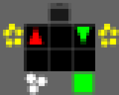
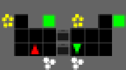
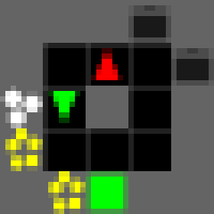

# Zero-Shot Coordination in Overcooked with Pixel Observations

JAX-based training and evaluation platform for zero-shot coordination (ZSC) in the [Overcooked](https://github.com/HumanCompatibleAI/overcooked_ai) cooperative cooking game. Agents learn to coordinate with unseen partners — including from raw pixel observations — as a step toward sim-to-real human-robot collaboration.

<p align="center">
  
  
  
</p>

## What is Zero-Shot Coordination?

In ZSC, an agent must cooperate with a partner it has **never seen before** — no shared training, no communication protocol, no prior interaction. The agent must independently learn behaviors that are compatible with diverse partner strategies.

This is the core challenge for deploying robots that work alongside humans: the robot can't train with every possible human, so it must learn general coordination skills.

## Methods

We implement five ZSC training methods, all built on PPO:

| Method | How it works |
|--------|-------------|
| **SP** | Self-play — agent trains with a copy of itself |
| **SP Population** | Train 16 diverse self-play agents, saving 35 checkpoints each (560 partners) |
| **MEP** | Maximum Entropy Population — population trained with diversity bonus, ego trained against it with prioritized sampling |
| **BCP** | Behavioral Cloning Play — ego trained against BC policies fit to human demonstration data |
| **FCP** | Fictitious Co-Play — ego trained against High/Medium/Low skill partners from the SP population |

Each method produces an **ego agent** evaluated on its ability to coordinate with unseen partners across 5 kitchen layouts.

## Observation Modes

Agents can observe the game in three ways:

| Mode | Shape | Description |
|------|-------|-------------|
| `egocentric` | (1274,) | 7×7 window centered on agent, rotated so agent faces south. Default for MLP. |
| `full` | (26, 5, 9) | Full padded grid with 26 feature channels. For grid CNN. |
| `pixel` | (1, 40, 72) | 8×8 tile sprites rendered from the game visualizer, palette-indexed. Decoded to RGB by the CNN. Same image a human would see. |

The pixel mode uses a pre-rendered **sprite atlas** (64 tile types, 76 unique colors) with **palette indexing** — storing 1 byte per pixel instead of 12, enabling training on a single 24GB GPU.

## Key Results

Cross-play evaluation of Run 3 (MLP egocentric) vs Run 4 (pixel CNN):

| Method | Self-play | vs SP Pop H | vs MEP-8 H | vs Egos | XP Overall |
|--------|-----------|-------------|------------|---------|------------|
| Run 3 MEP-8 (MLP) | 198 | 184 | 187 | 105 | 125 |
| Run 3 FCP (MLP) | 95 | 175 | 169 | 112 | 103 |
| **Run 4 FCP (pixel)** | **9** | **174** | **166** | **106** | **96** |

The pixel CNN agent **matches MLP cross-play performance** with strong partners (SP Pop H: 174 vs 175) despite observing raw 8×8 pixel images instead of engineered 1274-dim feature vectors. Self-play is low because the pixel ego was trained with MLP partners (dual-encoder setup).

Full results: [`reports/05_run3_vs_run4_crossplay_eval/crossplay_eval.md`](reports/05_run3_vs_run4_crossplay_eval/crossplay_eval.md)

## Architecture

**MLP (egocentric obs):** 2×256 Dense, separate actor/critic heads. 367K params.

**IMPALA Shallow CNN (pixel obs):** Conv(16, 8×8, stride=4) → Conv(32, 4×4, stride=2) → Dense(256). 185K params. Architecture from [Espeholt et al., ICML 2018](https://arxiv.org/abs/1802.01561). Handles free-position objects for future sim-to-real transfer.

## Comparison with JaxMARL

This repo extends the [JaxMARL](https://github.com/flairox/jaxmarl) Overcooked environment with ZSC training, pixel observations, and cross-play evaluation.

| Feature | JaxMARL | This repo |
|---------|---------|-----------|
| Training methods | IPPO self-play only | SP Pop, MEP, BCP, FCP |
| Agent framework | 2-agent, shared params | N agents, X unseen partners |
| Observation modes | Raw (H,W,26) grid | Egocentric 7×7 rotated, full grid, pixel sprites |
| Population training | None | SP Pop (16×35 ckpts), MEP Pop (entropy bonus) |
| Partner tiers | None | Per-layout H/M/L skill categorization |
| Cross-play eval | Training rewards only | H/M/L tiered eval, ego-vs-ego matrix |
| Network (CNN) | 3 conv → Dense(64) on 26-ch grid | IMPALA shallow → Dense(256) on pixel sprites |

Full comparison: [`reports/comparison_with_jaxmarl.md`](reports/comparison_with_jaxmarl.md)

## Quick Start

```bash
# Setup
conda env create -f environment.yml
conda activate jax_overcooked

# Train FCP with egocentric MLP (Run 3 style, ~35 min)
python train_fcp.py --seeds 0,1,2 --total-timesteps 100000000

# Train FCP with pixel CNN (Run 4 style, ~4.3h)
python train_fcp.py --seeds 0,1,2,3,4,5 --obs-encoding pixel --total-timesteps 100000000

# Evaluate
python evaluate.py --mode self-play-ego --agent-path checkpoints/fcp_n2x1_hetero_seed0.pkl
```

Note: FCP requires pre-trained SP Population checkpoints and layout scores. Run the full pipeline via `bash run_run3_ego_only.sh` (MLP) or `bash run_fcp_pixel.sh` (pixel).

## Project Structure

```
├── train_sp.py, train_sp_population.py    # Self-play training
├── train_mep.py                           # Maximum Entropy Population
├── train_bc.py, train_bcp.py              # Behavioral Cloning + BCP
├── train_fcp.py                           # Fictitious Co-Play
├── networks.py                            # ActorCritic, CNNActorCritic, IMPALACNNActorCritic
├── obs_encoding.py                        # ObsEncoder (egocentric/full/pixel), SpriteAtlas
├── ppo.py                                 # Shared PPO (Transition, GAE, ppo_update)
├── nxplay.py                              # N-XPlay partner selection + shuffling
├── reward_shaping.py                      # Configurable reward shaping
├── overcooked_env/                        # N-agent Overcooked (extended from JaxMARL)
├── evaluate.py                            # Self-play + cross-play evaluation
├── evaluate_pop_per_layout.py             # Per-layout population scoring
├── eval_ego_vs_ego.py                     # Full ego cross-play matrix
├── run_*.sh                               # Entry-point shell scripts
├── checkpoints/                           # Saved .pkl checkpoints
└── reports/                               # Per-run reports, surveys, eval results
    ├── 01_run1_mlp_3x64_baseline/
    ├── 02_run2_mlp_2x256_multihri_matched/
    ├── 03_run3_perlayout_hml_eval_mep/
    ├── 04_run4_cnn_pixel_human_equivalent/
    ├── 05_run3_vs_run4_crossplay_eval/
    ├── surveys/                           # Literature surveys
    └── pixel_samples/                     # Rendered sprite samples
```

## Experiment History

| Run | What changed | Key result |
|-----|-------------|------------|
| Run 1 | 3×64 MLP baseline | First working ZSC pipeline |
| Run 2 | 2×256 MLP, multiHRI-matched hyperparams | SP Pop self-play ~272 |
| Run 3 | Per-layout H/M/L, eval-based MEP sampling | MEP-8 XP Overall=125, FCP=103 |
| Run 4 | Pixel observations, IMPALA shallow CNN | Pixel FCP XP Overall=96 (matches MLP cross-play with strong partners) |

## Requirements

- NVIDIA GPU with ≥24GB VRAM (tested on RTX 3090)
- CUDA 12, JAX 0.4.38, Flax 0.10.4
- See `environment.yml` for full dependencies

## Citation

If you use this codebase, please cite the underlying methods:

- **FCP**: Strouse et al., ["Collaborating with Humans without Human Data"](https://arxiv.org/abs/2110.08176), NeurIPS 2021
- **MEP**: Zhao et al., ["Maximum Entropy Population-Based Training for Zero-Shot Human-AI Coordination"](https://arxiv.org/abs/2112.11701), AAAI 2023
- **JaxMARL**: Rutherford et al., ["JaxMARL: Multi-Agent RL Environments and Algorithms in JAX"](https://arxiv.org/abs/2311.10090), 2023
- **IMPALA**: Espeholt et al., ["IMPALA: Scalable Distributed Deep-RL with Importance Weighted Actor-Learner Architectures"](https://arxiv.org/abs/1802.01561), ICML 2018
